# ED Resolve

## Experiential Operational Decision Support for Emergency Department Flow

**Team:** GEOMETROGENESIS
**Project:** ED Resolve

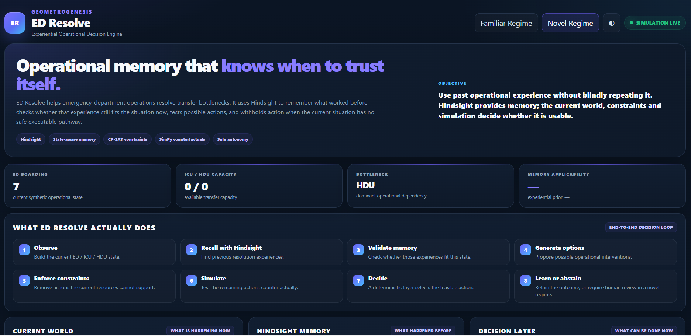

ED Resolve is an operational decision-support research prototype for recurring Emergency Department transfer bottlenecks.

The objective is simple:

> **When a similar operational problem happens again, use previous experience when it is actually relevant, test what is feasible now, compare possible interventions, and learn from the outcome.**

The prototype uses **Hindsight as the experiential memory layer** and combines it with current-state modeling, hard constraints, counterfactual simulation, deterministic selection, and outcome retention.

It is an **operational research prototype using synthetic scenarios**. It is not a clinical decision system and does not diagnose, prescribe treatment, or replace clinicians.

---

## 1. Problem Statement

### The problem

Emergency Department transfer delays often come from interacting operational dependencies rather than one isolated event. A transfer can depend on:

- ED boarding pressure
- ICU/HDU capacity
- bed readiness and cleaning
- transport availability
- coordination resources
- escalation resources
- competing transfer requests

The same type of bottleneck can happen again while the surrounding state is different. That creates a practical decision problem:

> **Which previous experience is relevant to the current state, what can still be executed, and what is likely to happen under each feasible intervention?**

### Why this is a serious operational problem

A 2026 prospective observational study at a tertiary-care centre in India examined 510 adults who stayed at least 24 hours in the ED without specialty transfer. The study reported system-related causes of delay including ICU/HDU bed waits and interdepartmental disputes. It supports the importance of hospital-wide operational interventions, but it does **not** validate ED Resolve or imply clinical impact from our synthetic prototype.

Research:

- [PubMed — Causes of Delayed Transfers From the Emergency Department to Speciality Units](https://pubmed.ncbi.nlm.nih.gov/42326213/)
- [PMC — Full text](https://pmc.ncbi.nlm.nih.gov/articles/PMC13275199/)

---

## 2. Technology Stack

The implementation is separated into layers so that memory, reasoning, feasibility, simulation, decision authority, and presentation remain inspectable.

| Layer | Technology used | Role in ED Resolve |
|---|---|---|
| **Frontend / UI** | HTML5, CSS3, JavaScript | Decision-support dashboard, familiar/novel views, memory display, simulation results, decision trace, Safe Mode |
| **Frontend serving / API** | FastAPI, Uvicorn | Serves the dashboard and exposes demo endpoints |
| **Backend** | Python 3.13, Pydantic v2 | Structured state, world models, candidates, constraints, decisions, outcomes |
| **Agent orchestration** | LangGraph | Stateful reasoning workflow and failure handling |
| **Reasoning / candidate generation** | GPT-OSS 120B via Groq | Generates candidate interventions and reasoning context |
| **Experiential memory** | Hindsight 0.10.1 | Recalls and retains operational resolution experience across episodes |
| **Memory retention** | GPT-OSS 20B via Hindsight | Extracts and retains structured experience from completed episodes |
| **Operational dependency graph** | NetworkX | Dominant dependency, graph criticality, and critical path |
| **Hard feasibility** | OR-Tools CP-SAT | Rejects interventions that violate current operational constraints |
| **Counterfactual simulation** | SimPy | Tests feasible interventions before final selection |
| **Numerical / experiment analysis** | NumPy, SciPy, pandas | Synthetic scenarios, metrics, and controlled analysis |
| **Version control** | Git, GitHub | Source history and reproducible project delivery |

### Planned extensions

PostgreSQL + SQLAlchemy/Alembic, PM4Py, richer hospital event streams, and a more production-oriented frontend are planned extensions rather than completed parts of the current vertical slice.

---

## 3. Research Context and Positioning

ED Resolve does **not** claim novelty for generic hospital bottleneck prediction, capacity forecasting, digital twins, or prescriptive recommendations. Those areas are already active in research and commercial systems.

For example, GE HealthCare's **CareIntellect for Operations**, announced September 15, 2026, provides a 72-hour view of emerging operational bottlenecks and pairs operational signals with actionable guidance across areas including capacity and throughput.

References:

- [GE HealthCare — CareIntellect for Operations](https://www.gehealthcare.com/en-us/products/software/careintellect/careintellect-for-operations)
- [GE HealthCare — September 15, 2026 announcement](https://www.gehealthcare.com/en-us/about/newsroom/press-releases/ge-healthcare-announces-careintellect-for-operations-helping-health-systems-optimize-resources-and-expand-access-to-care)

The narrower research direction of ED Resolve is **state-aware experiential reuse**:

> **Can institution-specific operational experience become a bounded computational resource for a future decision without blindly replaying an earlier action?**

This is closely related to recent work on state-aware memory for LLM agents. The 2026 ACL paper **SAMem** argues that globally similar experiences can be poorly aligned with the agent's current state, motivating memory retrieval conditioned on the current decision state.

- [ACL 2026 — SAMem: State-Aware Memory as a Fine-Grained Memory for LLM Agents in Decision-Making](https://aclanthology.org/2026.findings-acl.722/)

---

## 4. Why Hindsight Is Central

Hindsight is not used as generic conversation history. It is the **long-term experiential memory layer** of ED Resolve.

A completed operational episode can contribute experience about:

- operational conditions
- bottleneck identity
- scenario context
- graph/dependency context
- actions considered
- hard constraints
- expected consequences
- selected action
- observed outcome
- prediction error
- reusable lesson

### Hindsight retain → recall loop

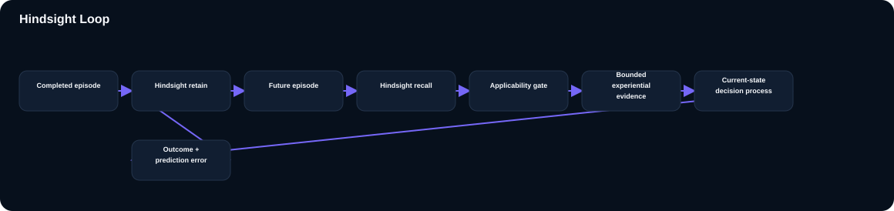

The project uses a dedicated ED Resolve memory bank and the Hindsight `retain()` / `recall()` flow to persist and reuse operational episodes.

The retain → recall path has been verified with the ED Resolve test flow. Previous experiences can include both successful and failed operational approaches, so the memory layer is not limited to a list of actions that happened to work once.

### Applicability gate

Retrieving an experience is only the first step.

ED Resolve combines:

- bottleneck match
- scenario match
- operational graph context
- semantic relevance

into an **experience applicability signal**.

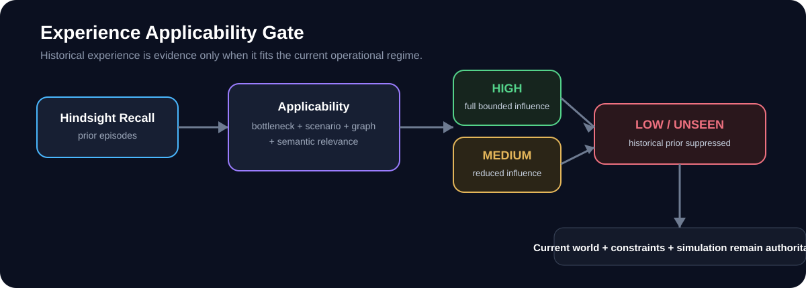

The key boundary is:

> **Memory can influence a decision. Memory cannot override the current operating state.**

---

## 5. Further Demo: Making Hindsight Visible

A central goal of the demo is to make Hindsight visibly change the evidence used by the agent rather than hiding memory behind a generic API call.

The running interface exposes:

**Recall → Validate → Influence → Learn**

### Recall

The system retrieves previous operational episodes from the ED Resolve Hindsight bank. These can include both successful and failed interventions.

### Validate

The retrieved experiences are compared with the current bottleneck, scenario, and operational state. Structurally aligned experience can receive bounded influence; structurally unseen experience can be suppressed.

### Influence

The applicable experience contributes a bounded experiential signal to the deterministic decision layer. Memory does not become a veto and cannot bypass the current-state constraints or simulation.

### Learn

After execution, the outcome is compared with what was expected. The resulting prediction error and lesson are retained for future episodes.

### Memory Matters experiment

The real Hindsight pipeline was verified with a controlled **Memory Matters** experiment. Tag-scoped recall recovered controlled experiences representing two failed `EXPEDITE_BED_CLEANING` episodes and two successful `ESCALATE_TO_BED_MANAGER` episodes. Historical support then changed the bounded decision scores for those actions.

In the full simulator case used for verification, the current-state simulation still had a large utility advantage for `EXPEDITE_BED_CLEANING`, so the final action did not flip.

This is intentional:

> **Memory changes the ranking, but it cannot override strong current-world evidence.**

A separate selector-only ablation can flip the final action when two options are sufficiently close, but that result is kept separate from the full simulator claim. ED Resolve therefore does **not** claim that Hindsight must change the final action on every end-to-end episode.

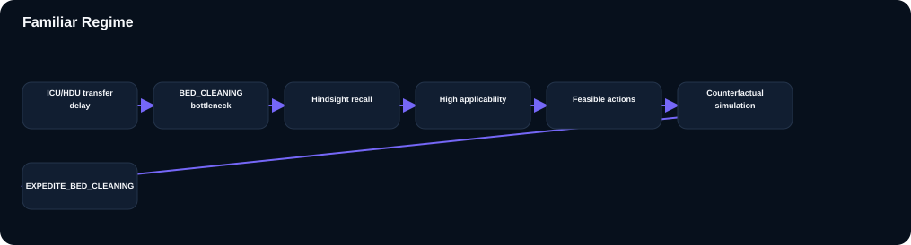

---

## 6. Product Interface

The dashboard is designed so a non-specialist can understand the objective first and then inspect the deeper decision layers.


The final interface keeps the project identity visible throughout the demo:

- **GEOMETROGENESIS**
- **ED Resolve**
- **Familiar Regime / Novel Regime**
- **Current World**
- **Hindsight Memory**
- **Decision Layer**
- **Counterfactual Simulation**
- **Safe Mode**

### UI sections

| UI section | What it explains |
|---|---|
| **Familiar Regime / Novel Regime** | Switches between a known operational regime and a deliberately unseen regime. |
| **Hero / Objective** | Explains the core problem and the role of Hindsight in one place. |
| **KPI row** | Shows ED boarding pressure, ICU/HDU capacity, dominant bottleneck, and memory applicability. |
| **What ED Resolve actually does** | Gives the eight-step end-to-end decision loop in plain language. |
| **Current World** | Shows the current scenario, bottleneck, graph dependency, critical path, and confidence. |
| **Hindsight Memory** | Shows recalled experiences, structural matches, and the bounded experiential prior. |
| **Decision Layer** | Shows the selected intervention or explains why autonomous action is withheld. |
| **How Hindsight is used** | Makes Recall → Validate → Influence → Learn explicit. |
| **Counterfactual Simulation** | Shows which candidate actions are feasible and what the simulator predicts. |
| **What the system demonstrates** | Summarizes memory use, bounded influence, counterfactuals, and Safe Mode behavior. |

### Plain-language pipeline

```text
1. Observe
   Build the current ED / ICU / HDU state.

2. Recall with Hindsight
   Find previous resolution experiences.

3. Validate memory
   Check whether those experiences fit this state.

4. Generate options
   Propose possible operational interventions.

5. Enforce constraints
   Remove actions current resources cannot support.

6. Simulate
   Test remaining actions counterfactually.

7. Decide
   A deterministic layer selects the feasible action.

8. Learn or abstain
   Retain the outcome, or require human review in a novel regime.
```

---

## 7. Core Decision Flow

The complete operational loop is intentionally simple:

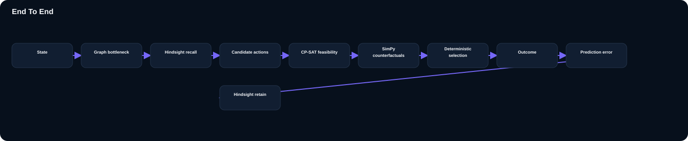

### Authority separation

ED Resolve deliberately separates proposal, feasibility, evaluation, and selection.

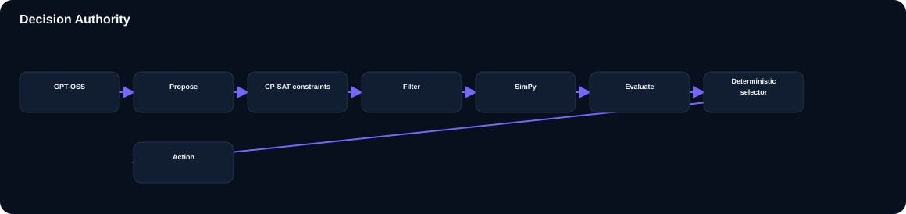

**LLM proposes. Constraints filter. Simulation evaluates. Deterministic logic selects. Hindsight remembers.**

---

## 8. Familiar Regime vs Novel Regime

### Familiar regime

A known operational pattern where relevant experiences exist.


A controlled synthetic episode can complete the full path:

```text
state
 → graph-conditioned bottleneck
 → Hindsight recall
 → applicability validation
 → candidate generation
 → CP-SAT feasibility
 → SimPy counterfactuals
 → deterministic selection
 → outcome comparison
 → Hindsight retention
```

### Novel regime

A deliberately unseen resource-collapse regime tests whether the system can **abstain** instead of overusing historical experience.

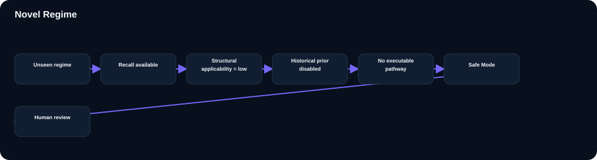

The system may still retrieve memories, but structural alignment is absent. Historical influence is therefore suppressed.

If the simulator finds no executable resolution pathway, ED Resolve enters **Safe Mode** and withholds autonomous action.

The intended behavior is:

> **When the current environment is outside the learned and executable regime, ED Resolve should be able to withhold autonomous action.**

---

## 9. Initial Prototype

The first vertical slice proved the basic chain:

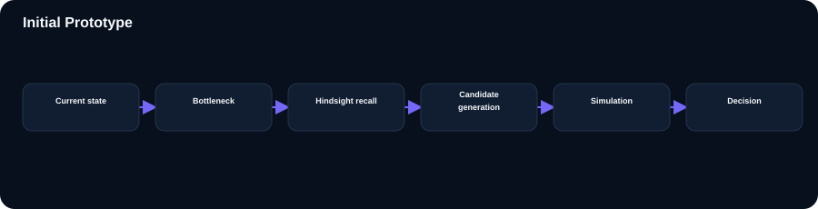

The early implementation exposed several weaknesses that shaped the final design:

- retrieved experience could be relevant semantically but poorly aligned with the current operational state;
- graph context needed stronger treatment as a structural signal;
- an LLM can propose an intervention that current resources cannot execute;
- an unseen regime needs an explicit abstention path;
- memory can change evidence scores without necessarily changing the final action in every controlled case.

These became engineering requirements rather than reasons to hide the early limitations.

---

## 10. Initial Findings

### Memory ablation

In a controlled synthetic comparison, memory changed the **decision scoring evidence** but did not change the final selected action in that particular case. This is intentionally reported as a negative finding rather than an unsupported claim of improvement.

### Retain → recall loop

A completed episode was retained in Hindsight and a later episode was able to recall the stored experience and use it as bounded evidence.

### End-to-end execution

A known ICU bed-cleaning episode completed the full path:

```text
State
 → graph bottleneck
 → Hindsight recall
 → candidate actions
 → CP-SAT feasibility
 → SimPy counterfactuals
 → deterministic selection
 → outcome
 → prediction error
 → Hindsight retain
```

One verified synthetic run produced approximately **48.7 minutes expected resolution time** and **48.1 minutes observed simulation outcome**, for roughly **0.6 minutes of prediction error**. These values belong to the synthetic operational simulator and are not clinical performance claims.

### Memory Matters: paired simulator search

To test whether the real simulator could naturally produce an end-to-end memory-driven action flip without changing the simulator, a paired search was run across **500 simulator seeds** and the controlled scenario suite.

No sufficiently close real counterfactual pair was found for a legitimate end-to-end flip. The closest observed utility gap was **20.125**.

The simulator was therefore **not modified to manufacture a flip**. The honest result is that memory changes bounded ranking evidence while the current-state simulation can remain decisive.

---

## 11. Final Architecture

The final system separates state, memory, reasoning, feasibility, simulation, selection, and learning.

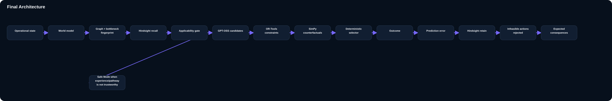

### Main components

**Operational state**

Structured ED, ICU/HDU, transfer, cleaning, transport, coordination, and escalation variables.

**World model**

Normalizes operational pressure, capacity, delay, resource conflict, graph criticality, dominant dependency, and critical path.

**Bottleneck fingerprint**

Creates a compact state representation that can condition memory and reasoning.

**Hindsight memory**

Provides long-term experiential recall and retention across episodes.

**Applicability gate**

Controls how strongly recalled experience can influence the current decision based on semantic relevance plus structural alignment.

**GPT-OSS**

Generates candidate interventions and reasoning context; it does not directly select the final action.

**OR-Tools CP-SAT**

Provides deterministic feasibility filtering for resource and operational constraints.

**SimPy**

Runs counterfactual operational simulations for feasible interventions.

**Deterministic selector**

Chooses the final action from current-state constraints, simulation results, and bounded experiential evidence.

**Safe Mode**

Withholds autonomous action when the current environment has no executable resolution pathway or the experiential regime is structurally unseen.

---

## 12. Final Improvements Over the Initial Prototype

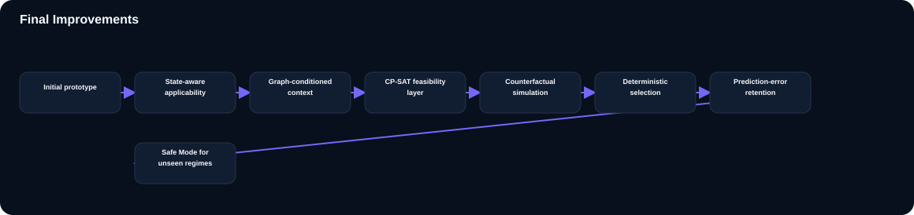

| Area | Initial prototype | Final vertical slice |
|---|---|---|
| Memory | Recall available | Recall + applicability control |
| State context | Mostly semantic | Bottleneck + graph structure + current state |
| Constraints | Candidate proposals | Explicit CP-SAT feasibility filtering |
| Evaluation | Basic action reasoning | Counterfactual comparison with SimPy |
| Decision authority | More model-dependent | Deterministic final selection |
| Failure handling | Limited | Safe Mode + human review path |
| Learning | Episode output | Expected vs actual + prediction error + retain |
| Interface | Prototype view | Decision-support dashboard with familiar/novel regimes |

---

## 13. Evaluation and Reproducibility

The evaluation is designed to isolate the contribution of memory rather than only reporting one final run.

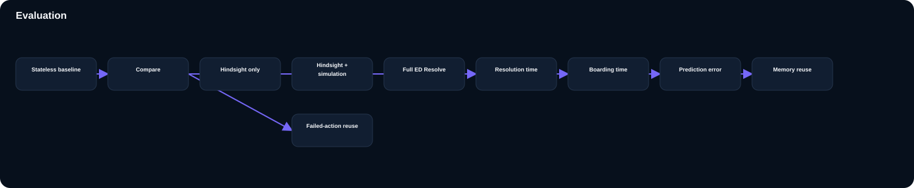

### Evaluation configurations

| Configuration | Hindsight | Simulation | Learning |
|---|---:|---:|---:|
| Stateless baseline | No | No | No |
| Memory system | Yes | No | No |
| Memory + simulation | Yes | Yes | No |
| Full ED Resolve | Yes | Yes | Yes |

Useful metrics include:

- resolution time
- ED boarding time
- resolution rate
- P90 resolution time
- resource conflicts
- escalation count
- memory reuse
- repeated failed-action rate
- prediction error
- learning gain

Experiments use controlled synthetic scenarios and reproducible seeds. The Memory Matters paired search tested 500 simulator seeds and did not find a sufficiently close real counterfactual pair for a legitimate end-to-end action flip. No real-world clinical performance claim is inferred from these simulations.

---

## 14. Repository Structure

```text
ED-Resolve/
├── backend/
│   ├── agent/
│   │   ├── decision.py
│   │   ├── graph.py
│   │   ├── nodes.py
│   │   ├── outcome.py
│   │   ├── prompts.py
│   │   └── state.py
│   ├── memory/
│   │   └── hindsight_memory.py
│   └── simulation/
│       ├── actions.py
│       ├── constraints.py
│       ├── ed_simulator.py
│       ├── metrics.py
│       └── models.py
├── data/
│   └── synthetic/
├── docs/
│   ├── dashboard-final.png
│   ├── familiar-decision.png
│   ├── hindsight-panel.png
│   ├── novel-safe-mode.png
│   ├── hindsight-loop.svg
│   ├── applicability-gate.svg
│   ├── end-to-end.svg
│   ├── decision-authority.svg
│   ├── decision-flow.svg
│   ├── familiar-regime.svg
│   ├── novel-regime.svg
│   ├── initial-prototype.svg
│   ├── final-architecture.svg
│   ├── final-improvements.svg
│   └── evaluation.svg
├── frontend/
│   ├── server.py
│   └── static/
│       └── index.html
├── scripts/
│   ├── cleanup_memory_matters.py
│   ├── demo_evaluation.py
│   ├── test_memory_flip.py
│   ├── test_memory_matters_flip.py
│   └── test_memory_pipeline.py
├── .env.example
├── .gitignore
├── README.md
└── requirements.txt
```

---

## 15. Safety and Scope

ED Resolve is an **operational decision-support research prototype** using synthetic scenarios.

It does not:

- diagnose patients
- prescribe medication
- recommend clinical treatment
- replace clinicians
- autonomously make clinical decisions
- claim regulatory approval
- represent a production hospital information system

A real deployment would require domain-specific validation, privacy and security controls, interoperability validation, governance, human oversight, and appropriate regulatory assessment.

The simulator and decision policies demonstrate the architecture and learning loop; they do not certify hospital safety or operational performance.

---

## 16. Future Scope

The architecture can be extended toward:

- PostgreSQL-backed episode and audit persistence
- SQLAlchemy/Alembic database migrations and durable operational storage
- PM4Py-based process-mining analysis
- richer hospital event streams
- larger intervention spaces
- multi-hospital transfer of experiential knowledge with privacy controls
- stronger calibration of applicability and uncertainty
- longitudinal evaluation across repeated episodes
- FHIR-compatible interoperability boundaries
- controlled online learning using outcome and prediction-error signals

The intended direction is not simply to make the model remember more. It is to make **experience more useful, more state-aware, more auditable, and safer to reuse**.

---

## 17. Setup

### Requirements

- Python 3.13+
- Hindsight 0.10.1
- Groq API access for GPT-OSS

### Environment

Create a local `.env` from `.env.example` and supply your own credentials. Never commit `.env`.

### Start Hindsight

```powershell
hindsight-api --host 127.0.0.1 --port 8888
```

### Start the ED Resolve dashboard

```powershell
uvicorn frontend.server:app --host 127.0.0.1 --port 8000
```

Open:

```text
http://127.0.0.1:8000
```

The dashboard contains the **Familiar Regime** and **Novel Regime** synthetic scenarios used in the demo.

---

## 18. References

1. [PubMed — Causes of Delayed Transfers From the Emergency Department to Speciality Units](https://pubmed.ncbi.nlm.nih.gov/42326213/)
2. [PMC — Full study](https://pmc.ncbi.nlm.nih.gov/articles/PMC13275199/)
3. [GE HealthCare — CareIntellect for Operations](https://www.gehealthcare.com/en-us/products/software/careintellect/careintellect-for-operations)
4. [GE HealthCare — September 15, 2026 announcement](https://www.gehealthcare.com/en-us/about/newsroom/press-releases/ge-healthcare-announces-careintellect-for-operations-helping-health-systems-optimize-resources-and-expand-access-to-care)
5. [ACL 2026 — SAMem](https://aclanthology.org/2026.findings-acl.722/)
6. [Hindsight documentation](https://docs.hindsight.vectorize.io/)
7. [Hindsight GitHub](https://github.com/vectorize-io/hindsight)
8. [Hindsight paper](https://arxiv.org/abs/2512.12818)

---

## Project Principle

> **Memory informs. Constraints protect. Simulation tests. Deterministic logic selects. Outcomes teach.**

**GEOMETROGENESIS**
**ED Resolve**

> Building state-aware operational agents that use experiential memory without blindly trusting the past.
