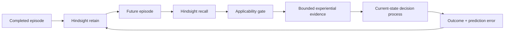
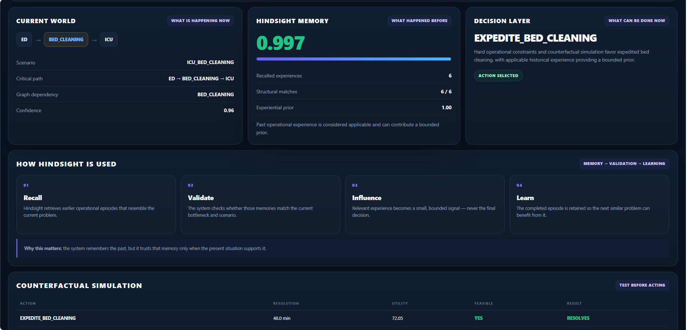
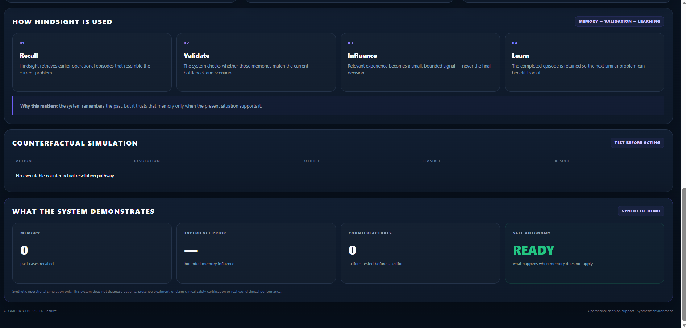
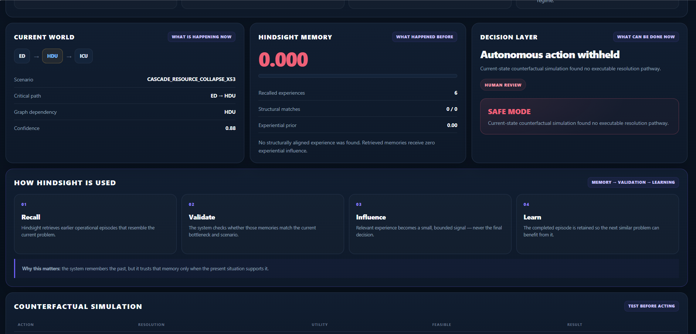
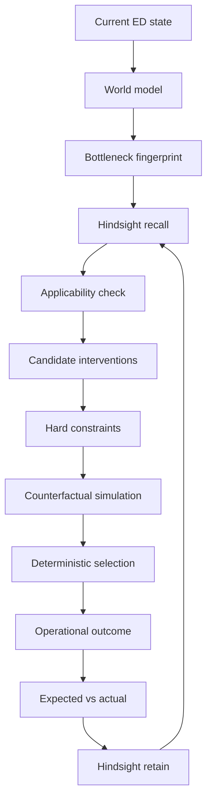
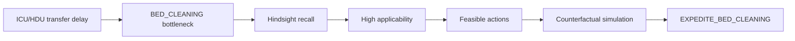
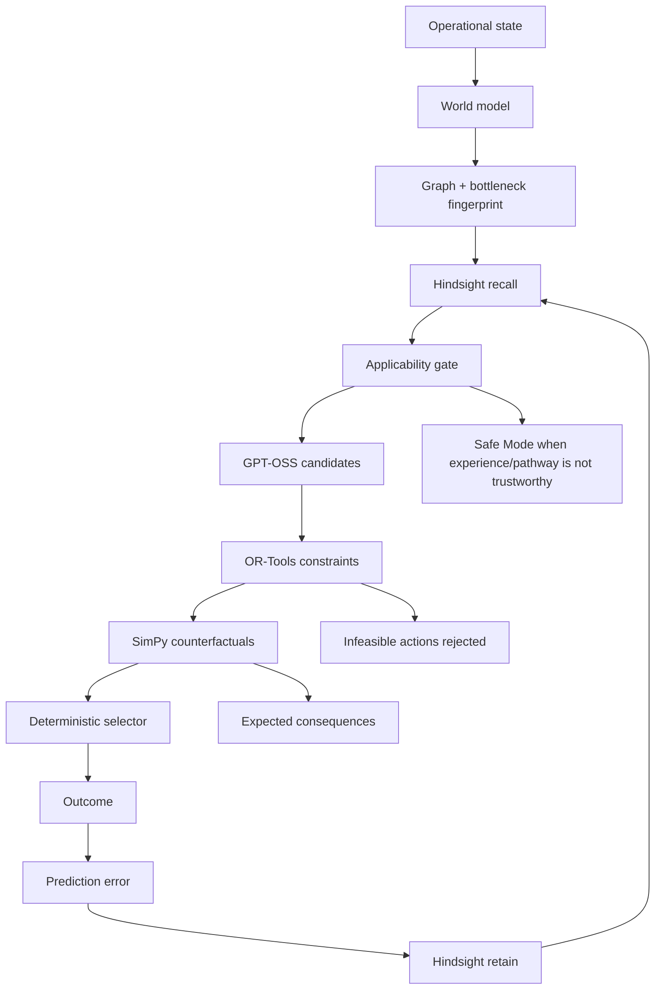
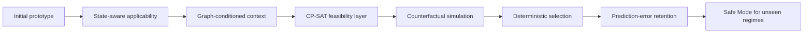
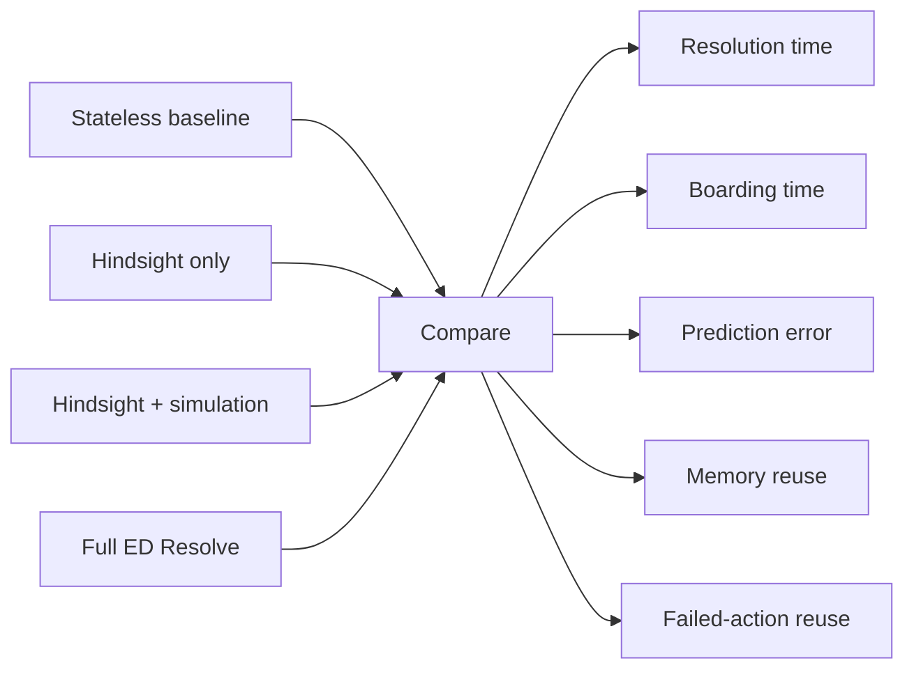

# ED Resolve

## Experiential Operational Decision Support for Emergency Department Flow

**Team:** GEOMETROGENESIS  
**Project:** ED Resolve


ED Resolve is an operational decision-support research prototype for recurring Emergency Department transfer bottlenecks.

The objective is simple:

> **When a similar operational problem happens again, use previous experience when it is actually relevant, test what is feasible now, compare possible interventions, and learn from the outcome.**

The prototype uses **Hindsight as the experiential memory layer** and combines it with current-state modeling, hard constraints, counterfactual simulation, deterministic selection, and outcome retention.

It is an **operational research prototype using synthetic scenarios**. It is not a clinical decision system and does not diagnose, prescribe treatment, or replace clinicians.

---

## 1. Problem Statement

### The problem

Emergency Department transfer delays often come from interacting operational dependencies rather than one isolated event. A transfer can depend on:

- ED boarding pressure
- ICU/HDU capacity
- bed readiness and cleaning
- transport availability
- coordination resources
- escalation resources
- competing transfer requests

The same type of bottleneck can happen again while the surrounding state is different. That creates a practical decision problem:

> **Which previous experience is relevant to the current state, what can still be executed, and what is likely to happen under each feasible intervention?**

### Why this is a serious operational problem

A 2026 prospective observational study at a tertiary-care centre in India examined 510 adults who stayed at least 24 hours in the ED without specialty transfer. The study reported system-related causes of delay including ICU/HDU bed waits and interdepartmental disputes. It supports the importance of hospital-wide operational interventions, but it does **not** validate ED Resolve or imply clinical impact from our synthetic prototype.

Research:

- [PubMed — Causes of Delayed Transfers From the Emergency Department to Speciality Units](https://pubmed.ncbi.nlm.nih.gov/42326213/)
- [PMC — Full text](https://pmc.ncbi.nlm.nih.gov/articles/PMC13275199/)

---

## 2. Technology Stack

The implementation is separated into layers so that memory, reasoning, feasibility, simulation, decision authority, and presentation remain inspectable.

| Layer | Technology used | Role in ED Resolve |
|---|---|---|
| **Frontend / UI** | HTML5, CSS3, JavaScript | Decision-support dashboard, familiar/novel views, memory display, simulation results, decision trace, Safe Mode |
| **Frontend serving / API** | FastAPI, Uvicorn | Serves the dashboard and exposes demo endpoints |
| **Backend** | Python 3.13, Pydantic v2 | Structured state, world models, candidates, constraints, decisions, outcomes |
| **Agent orchestration** | LangGraph | Stateful reasoning workflow and failure handling |
| **Reasoning / candidate generation** | GPT-OSS 120B via Groq | Generates candidate interventions and reasoning context |
| **Experiential memory** | Hindsight 0.10.1 | Recalls and retains operational resolution experience across episodes |
| **Memory retention** | GPT-OSS 20B via Hindsight | Extracts and retains structured experience from completed episodes |
| **Operational dependency graph** | NetworkX | Dominant dependency, graph criticality, and critical path |
| **Hard feasibility** | OR-Tools CP-SAT | Rejects interventions that violate current operational constraints |
| **Counterfactual simulation** | SimPy | Tests feasible interventions before final selection |
| **Numerical / experiment analysis** | NumPy, SciPy, pandas | Synthetic scenarios, metrics, and controlled analysis |
| **Version control** | Git, GitHub | Source history and reproducible project delivery |

### Planned extensions

PostgreSQL + SQLAlchemy/Alembic, PM4Py, and a richer production frontend are planned extensions rather than completed parts of the current vertical slice.

---

## 3. Research Context and Positioning

ED Resolve does **not** claim novelty for generic hospital bottleneck prediction, capacity forecasting, digital twins, or prescriptive recommendations. Those areas are already active in research and commercial systems.

For example, GE HealthCare's **CareIntellect for Operations**, announced September 15, 2026, provides a 72-hour view of emerging operational bottlenecks and pairs operational signals with actionable guidance across areas including capacity and throughput.

References:

- [GE HealthCare — CareIntellect for Operations](https://www.gehealthcare.com/en-us/products/software/careintellect/careintellect-for-operations)
- [GE HealthCare — September 15, 2026 announcement](https://www.gehealthcare.com/en-us/about/newsroom/press-releases/ge-healthcare-announces-careintellect-for-operations-helping-health-systems-optimize-resources-and-expand-access-to-care)

The narrower research direction of ED Resolve is **state-aware experiential reuse**:

> **Can institution-specific operational experience become a bounded computational resource for a future decision without blindly replaying an earlier action?**

This is closely related to recent work on state-aware memory for LLM agents. The 2026 ACL paper **SAMem** argues that globally similar experiences can be poorly aligned with the agent's current state, motivating memory retrieval conditioned on the current decision state.

- [ACL 2026 — SAMem: State-Aware Memory as a Fine-Grained Memory for LLM Agents in Decision-Making](https://aclanthology.org/2026.findings-acl.722/)

---

## 4. Why Hindsight Is Central

Hindsight is not used as generic conversation history. It is the **long-term experiential memory layer** of ED Resolve.

A completed episode can contribute experience about:

- the operational conditions
- the bottleneck
- the dependency structure
- interventions considered
- hard constraints
- expected consequences
- the selected action
- the observed outcome
- the prediction error
- the reusable lesson

### Hindsight loop



The critical safety idea is:

> **A previous success becomes evidence for a new decision, not a hard-coded rule.**

Official references:

- [Hindsight documentation](https://docs.hindsight.vectorize.io/)
- [Hindsight GitHub](https://github.com/vectorize-io/hindsight)
- [Hindsight paper](https://arxiv.org/abs/2512.12818)

---

## 5. Product Interface

The dashboard is designed so a non-specialist can understand the objective first and then inspect the deeper decision layers.

### Final dashboard


The final interface keeps the project identity visible throughout the demo:

- **GEOMETROGENESIS**
- **ED Resolve**
- **Familiar Regime / Novel Regime**
- **Current World**
- **Hindsight Memory**
- **Decision Layer**
- **Counterfactual Simulation**
- **Safe Mode**

### Familiar regime: memory-informed decision



The familiar regime shows the normal decision path: the current bottleneck is identified, relevant Hindsight experience is recalled, applicability is high, feasible interventions are evaluated, and a deterministic action is selected.

### How Hindsight appears in the product



The UI exposes the four operational roles of Hindsight directly:

**Recall → Validate → Influence → Learn**

This makes the memory system inspectable rather than hiding it behind a generic chat interface.

### Novel regime: safe autonomy boundary



The novel regime demonstrates the opposite behavior. When the current state is structurally outside the supported experiential regime and no executable counterfactual pathway remains, ED Resolve withholds autonomous action and requests human review.

## 6. Core Decision Flow

The complete operational loop is intentionally simple:



The division of authority is:


**LLM proposes. Constraints filter. Simulation evaluates. Deterministic logic selects. Hindsight remembers.**

---

## 7. Familiar Regime vs Novel Regime

### Familiar regime

A known operational pattern where relevant experiences exist.



### Novel regime

A deliberately unseen resource-collapse regime tests whether the system can **abstain** instead of overusing historical experience.


This is one of the important differences between **memory** and **safe experiential decision support**.

---

## 8. Initial Prototype

The first vertical slice proved the basic chain:


The prototype also exposed several weaknesses that shaped the final design:

- retrieved experience could be relevant semantically but poorly aligned with the current operational state
- graph context needed stronger treatment as a structural signal
- an LLM can propose an intervention that current resources cannot execute
- an unseen regime needs an explicit abstention path
- memory can change evidence scores without necessarily changing the final action in every controlled case

These became engineering requirements rather than reasons to hide the early limitations.

---

## 9. Initial Findings

### Memory ablation

In a controlled synthetic comparison, memory changed the **decision scoring evidence** but did not change the final selected action in that particular case. This is intentionally reported as a negative finding rather than an unsupported claim of improvement.

### Retain → recall loop

A completed episode was retained in Hindsight and a later episode was able to recall the stored experience and use it as bounded evidence.

### End-to-end execution

A known ICU bed-cleaning episode completed the full path:


A verified synthetic run produced an expected resolution time of about **48.7 minutes** and an observed simulation outcome of about **48.1 minutes**, giving a prediction error of about **0.6 minutes**. These figures belong to the synthetic operational simulator and are not clinical performance results.

---

## 10. Final Architecture

The final system separates state, memory, reasoning, feasibility, simulation, selection, and learning.



### Main components

**Operational state**  
Structured ED, ICU/HDU, transfer, cleaning, transport, coordination, and escalation variables.

**World model**  
Normalizes operational pressure, capacity, delay, resource conflict, graph criticality, dominant dependency, and critical path.

**Bottleneck fingerprint**  
Creates a compact state representation that can condition memory and reasoning.

**Hindsight memory**  
Provides long-term experiential recall and retention across episodes.

**Applicability gate**  
Controls how strongly recalled experience can influence the current decision based on semantic relevance plus structural alignment.

**GPT-OSS**  
Generates candidate interventions and reasoning context; it does not directly select the final action.

**OR-Tools CP-SAT**  
Provides deterministic feasibility filtering for resource and operational constraints.

**SimPy**  
Runs counterfactual operational simulations for feasible interventions.

**Deterministic selector**  
Chooses the final action from current-state constraints, simulation results, and bounded experiential evidence.

**Safe Mode**  
Withholds autonomous action when the current environment has no executable resolution pathway or the experiential regime is structurally unseen.

---

## 11. Final Improvements Over the Initial Prototype



| Area | Initial prototype | Final vertical slice |
|---|---|---|
| Memory | Recall available | Recall + applicability control |
| State context | Mostly semantic | Bottleneck + graph structure + current state |
| Constraints | Candidate proposals | Explicit CP-SAT feasibility filtering |
| Evaluation | Basic action reasoning | Counterfactual comparison with SimPy |
| Decision authority | More model-dependent | Deterministic final selection |
| Failure handling | Limited | Safe Mode + human review path |
| Learning | Episode output | Expected vs actual + prediction error + retain |
| Interface | Prototype view | Decision-support dashboard with familiar/novel regimes |

---

## 12. Evaluation and Reproducibility

The evaluation should isolate the contribution of memory rather than only reporting one final run.



Useful metrics include:

- resolution time
- ED boarding time
- resolution rate
- P90 resolution time
- resource conflicts
- escalation count
- memory reuse
- repeated failed-action rate
- prediction error

Experiments use controlled synthetic scenarios and reproducible seeds. Synthetic results are for algorithm development and evaluation, not clinical effectiveness claims.

---

## 13. Repository Structure

```text
ED Resolve/
├── backend/
│   ├── agent/
│   ├── memory/
│   └── simulation/
├── data/
│   └── synthetic/
├── docs/
│   └── dashboard-preview.png
├── frontend/
│   ├── server.py
│   └── static/
├── scripts/
├── .env.example
├── .gitignore
├── README.md
└── requirements.txt
```

---

## 14. Safety and Scope

ED Resolve is an **operational decision-support research prototype**.

It does not:

- diagnose patients
- prescribe medication
- recommend clinical treatment
- replace clinicians
- autonomously make clinical decisions
- claim regulatory approval
- represent a production hospital information system

A real deployment would require domain-specific validation, privacy and security controls, interoperability validation, governance, human oversight, and appropriate regulatory assessment.

---

## 15. Future Scope

The architecture can be extended toward:

- PostgreSQL-backed episode and audit persistence
- PM4Py-based process-mining analysis
- richer hospital event streams
- larger intervention spaces
- multi-hospital transfer of experiential knowledge with privacy controls
- stronger calibration of applicability and uncertainty
- longitudinal evaluation across repeated episodes
- FHIR-compatible interoperability boundaries
- controlled online learning using outcome and prediction-error signals

The intended direction is not simply to make the model remember more. It is to make **experience more useful, more state-aware, more auditable, and safer to reuse**.

---

## 16. Setup

### Requirements

- Python 3.13+
- Hindsight 0.10.1
- Groq API access for GPT-OSS

### Environment

Create a local `.env` from `.env.example` and supply your own credentials. Never commit `.env`.

### Start Hindsight

```powershell
hindsight-api --host 127.0.0.1 --port 8888
```

### Start the ED Resolve dashboard

```powershell
uvicorn frontend.server:app --host 127.0.0.1 --port 8000
```

Open:

```text
http://127.0.0.1:8000
```

---

## 17. References

1. [PubMed — Causes of Delayed Transfers From the Emergency Department to Speciality Units](https://pubmed.ncbi.nlm.nih.gov/42326213/)
2. [PMC — Full study](https://pmc.ncbi.nlm.nih.gov/articles/PMC13275199/)
3. [GE HealthCare — CareIntellect for Operations](https://www.gehealthcare.com/en-us/products/software/careintellect/careintellect-for-operations)
4. [GE HealthCare — September 15, 2026 announcement](https://www.gehealthcare.com/en-us/about/newsroom/press-releases/ge-healthcare-announces-careintellect-for-operations-helping-health-systems-optimize-resources-and-expand-access-to-care)
5. [ACL 2026 — SAMem](https://aclanthology.org/2026.findings-acl.722/)
6. [Hindsight documentation](https://docs.hindsight.vectorize.io/)
7. [Hindsight GitHub](https://github.com/vectorize-io/hindsight)
8. [Hindsight paper](https://arxiv.org/abs/2512.12818)

---

## Project principle

> **Memory informs. Constraints protect. Simulation tests. Deterministic logic selects. Outcomes teach.**
