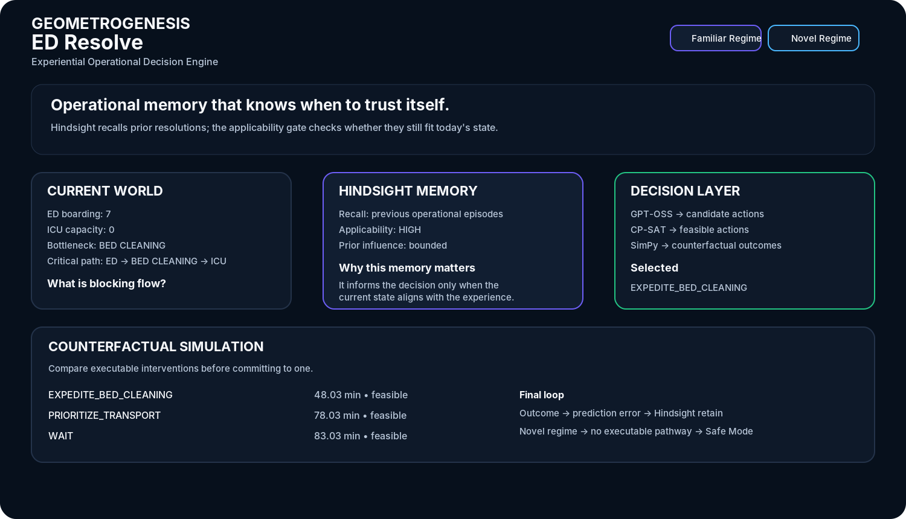
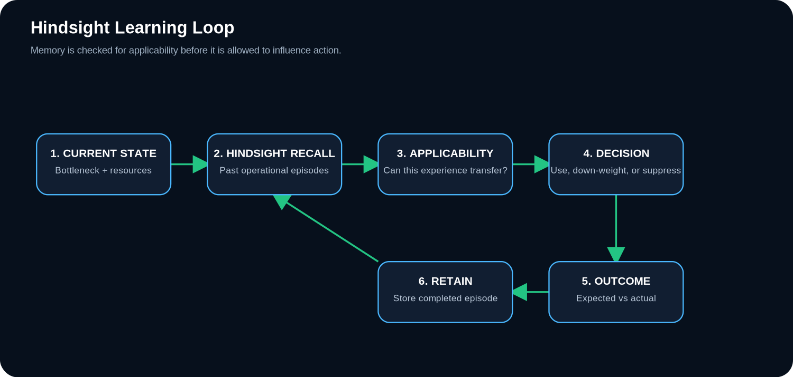
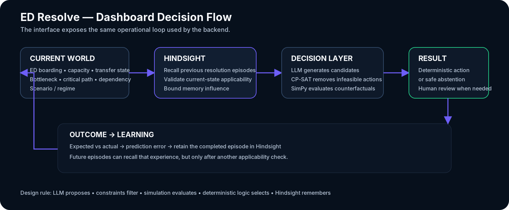
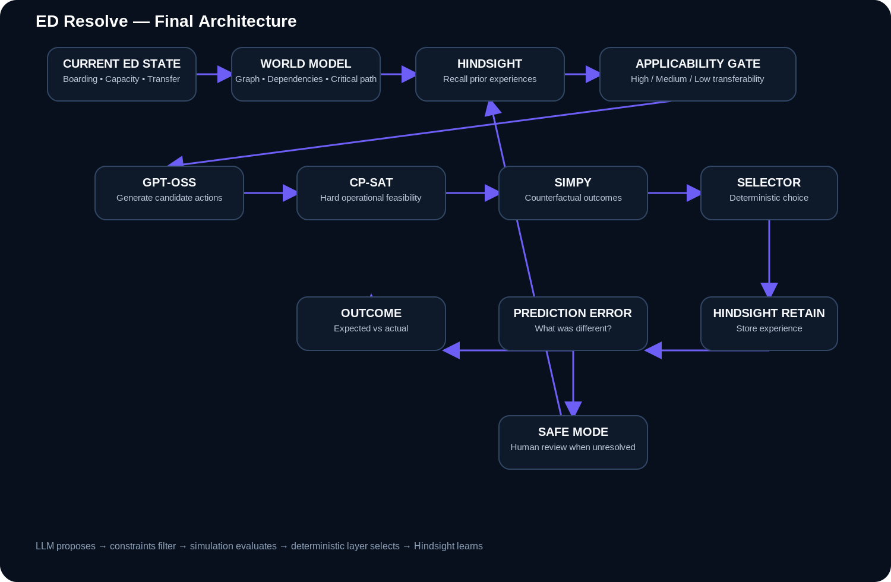
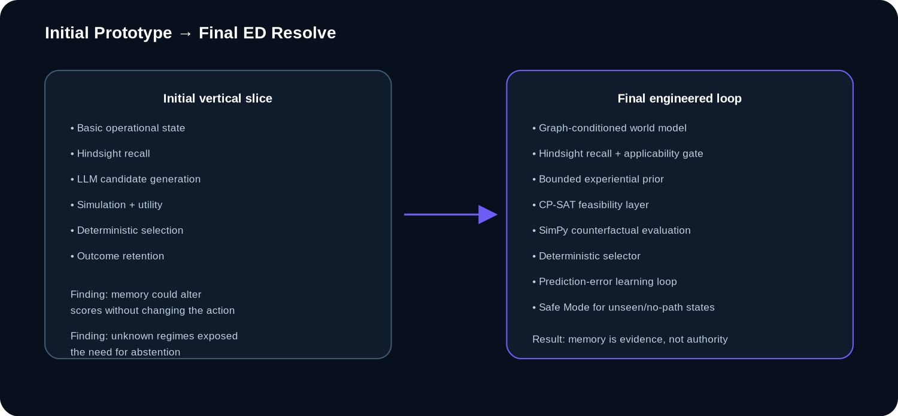

# ED Resolve

## Experiential Operational Decision Support for Emergency Department Flow

**Team:** GEOMETROGENESIS  
**Project:** ED Resolve



ED Resolve is an operational decision-support prototype for recurring Emergency Department bottlenecks, focused on transfer delays between the ED and downstream units.

The system is built around one practical question:

> **When a similar operational problem happens again, can a decision system use previous operational experience without blindly repeating the past?**

ED Resolve combines current-state modeling, Hindsight experiential memory, candidate generation, hard operational constraints, counterfactual simulation, deterministic selection, outcome comparison, and experience retention.

It is intentionally an **operational research prototype**, not a clinical decision system. It does not diagnose patients, prescribe treatment, or replace clinicians.

---

## 1. Problem Statement

### The operational problem

Emergency Department delays are often produced by interacting system dependencies rather than one isolated event.

A transfer can depend on:

- ED boarding pressure
- destination-unit capacity
- bed readiness and cleaning
- transport availability
- interdepartmental coordination
- escalation resources
- competing transfer requests

The same class of bottleneck may appear repeatedly, while the exact operational state changes from episode to episode.

A previous resolution may have worked because the destination unit had capacity, a cleaning resource was available, transport was accessible, or a coordinator could intervene. A later episode can look similar while having different constraints.

The decision problem is therefore larger than simple bottleneck detection:

> **Given the current state, what previous experience is relevant, what still applies, what can actually be executed, and what is likely to happen under each feasible intervention?**

### Why this matters

A 2026 prospective observational study at a tertiary-care hospital in India examined 510 adults who stayed in the ED for at least 24 hours without specialty transfer. The study reported system-related causes in about 70% of delayed cases, including ICU/HDU bed waits and interdepartmental disputes. The study's conclusion emphasizes hospital-wide operational interventions for prolonged boarding. 

Research:

- [PubMed — Causes of Delayed Transfers From the Emergency Department to Speciality Units](https://pubmed.ncbi.nlm.nih.gov/42326213/)
- [Full text — PMC](https://pmc.ncbi.nlm.nih.gov/articles/PMC13275199/)

This motivates ED Resolve, but it does **not** imply that our prototype has demonstrated clinical impact. The present evaluation uses synthetic operational scenarios.

---

## 2. Technology Stack

The implementation is intentionally separated into layers so memory, reasoning, feasibility, simulation, decision authority, and the interface remain independently inspectable.

| Layer | Technology used | Purpose in ED Resolve |
|---|---|---|
| **Frontend / UI** | HTML5, CSS3, JavaScript | Decision-support dashboard, familiar/novel regime views, memory display, simulation table, decision trace, and Safe Mode presentation |
| **Frontend serving / API** | FastAPI, Uvicorn | Serves the dashboard and exposes the demo execution endpoints |
| **Backend** | Python 3.13, FastAPI, Pydantic v2 | Structured state, world models, candidates, constraints, decisions, outcomes, and API serialization |
| **Agent orchestration** | LangGraph | Coordinates the stateful reasoning graph and failure handling |
| **Reasoning / candidate generation** | GPT-OSS 120B via Groq | Builds reasoning context and proposes candidate operational interventions |
| **Experiential memory** | Hindsight 0.10.1 | Recalls and retains operational resolution experiences across episodes |
| **Memory retention** | GPT-OSS 20B via Hindsight | Extracts/retains structured experience from completed episodes |
| **Operational graph** | NetworkX | Represents dependencies, graph criticality, dominant dependencies, and critical paths |
| **Hard constraints** | OR-Tools CP-SAT | Rejects interventions that are infeasible under current operational constraints |
| **Counterfactual simulation** | SimPy | Tests feasible interventions before final selection |
| **Numerical / experiment analysis** | NumPy, SciPy, pandas | Synthetic scenario generation, numerical features, evaluation, and analysis |
| **Version control** | Git, GitHub | Reproducible source history and project delivery |

### Planned extensions

The design can be extended with PostgreSQL + SQLAlchemy/Alembic for durable structured persistence, PM4Py for process-mining analysis, and a richer production frontend. These are kept separate from the implemented vertical slice and are not presented as completed functionality.

---

## 3. Research Context and Positioning

Hospital operational intelligence is already an active product and research area. ED Resolve therefore does **not** claim novelty in generic ED bottleneck prediction, bed-capacity forecasting, digital twins, or prescriptive operational recommendations.

For example, GE HealthCare announced **CareIntellect for Operations** in September 2026, describing a system that forecasts operational bottlenecks, analyzes bed availability, delays, staffing and wait times, and provides prescriptive guidance for hospital operations.

Research / product reference:

- [GE HealthCare — CareIntellect for Operations](https://www.gehealthcare.com/en-us/products/software/careintellect/careintellect-for-operations)
- [GE HealthCare — September 15, 2026 announcement](https://www.gehealthcare.com/en-us/about/newsroom/press-releases/ge-healthcare-announces-careintellect-for-operations-helping-health-systems-optimize-resources-and-expand-access-to-care)

The project therefore focuses on a narrower question:

> **Can institution-specific operational experience become a bounded, state-aware computational resource for future decisions?**

This is aligned with recent research arguing that coarse experiential memory can retrieve experiences that are globally similar but poorly aligned with the agent's current state.

- [ACL 2026 — SAMem: State-Aware Memory as a Fine-Grained Memory for LLM Agents in Decision-Making](https://aclanthology.org/2026.findings-acl.722/)

---

## 4. What ED Resolve Adds

The core idea is **state-aware experiential reuse inside a constrained operational decision loop**.

A conventional operational pipeline can look like:

```text
Current State
    |
    v
Prediction / Optimization
    |
    v
Recommendation
```

ED Resolve adds persistent experience and a validation step:

```text
Current State
    |
    v
World Model + Bottleneck Fingerprint
    |
    v
Hindsight Recall
    |
    v
Applicability Validation
    |
    v
Candidate Interventions
    |
    v
Hard Constraints
    |
    v
Counterfactual Simulation
    |
    v
Deterministic Selection
    |
    v
Outcome
    |
    v
Expected vs Actual
    |
    v
Hindsight Retention
    |
    v
Future Episodes
```

The intended authority structure is deliberately simple:

> **LLM proposes. Constraints filter. Simulation evaluates. Deterministic logic selects. Hindsight remembers.**

The important distinction is that a previous success becomes **evidence**, not a hard-coded rule.

---

## 5. How Hindsight Is Used

Hindsight is not used as generic chat history in ED Resolve. It is the long-term **experiential memory layer**.

Each completed episode can contribute experience containing:

- the operational conditions
- bottleneck identity
- scenario context
- graph/dependency context
- actions considered
- hard constraints
- expected consequences
- selected action
- observed outcome
- prediction error
- reusable lesson

When another episode occurs, Hindsight recalls relevant past experience. ED Resolve then checks whether those memories still apply to the current state.



This creates an important safety boundary:

```text
Hindsight Recall
      |
      v
Applicability Gate
      |
      +----------------------+----------------------+
      |                      |                      |
      v                      v                      v
    HIGH                   MEDIUM                  LOW
      |                      |                      |
 bounded influence      reduced influence      no historical prior
      |                      |                      |
      +----------------------+----------------------+
                             |
                             v
                    Current-state evaluation
```

Official references:

- [Hindsight documentation](https://docs.hindsight.vectorize.io/)
- [Hindsight GitHub](https://github.com/vectorize-io/hindsight)
- [Hindsight research paper](https://arxiv.org/abs/2512.12818)

---

## 6. Product Interface

The UI is designed to explain the system to a non-specialist first and expose deeper layers only when needed.


The dashboard makes four things visible in one place:

1. **Current World** — what is happening now.
2. **Hindsight Memory** — what previous experiences were recalled and whether they still apply.
3. **Decision Layer** — what was proposed, what was rejected by constraints, and what was evaluated.
4. **Counterfactual Simulation** — what each feasible intervention is expected to do.

A fifth state is important for safety:

5. **Safe Mode** — when the current regime has no executable resolution pathway, the system withholds autonomous action and requests human review.

### Familiar regime

A known operational regime where relevant previous experience exists.

Example:

```text
ICU / HDU transfer delay
        |
        v
BED_CLEANING is dominant
        |
        v
Hindsight recalls relevant experience
        |
        v
Applicability is high
        |
        v
Feasible interventions are simulated
        |
        v
EXPEDITE_BED_CLEANING selected
```

### Novel regime

A deliberately unseen resource-collapse regime.

The system may still retrieve memories, but the structural applicability gate prevents unrelated experiences from becoming a strong prior. When the current environment has no executable resolution pathway, the system enters Safe Mode.

### UI decision flow



---

## 7. Initial Prototype

The first implementation focused on proving the core vertical slice:

```text
Current State
    |
    v
Bottleneck Detection
    |
    v
Hindsight Recall
    |
    v
Candidate Generation
    |
    v
Counterfactual Simulation
    |
    v
Decision
```

The prototype established that the core decision loop could run end-to-end, but it also exposed several weaknesses:

- historical memory could be retrieved without sufficient state alignment
- graph context was not yet strong enough to condition retrieval safely
- the language model could propose operationally impossible actions without a hard feasibility layer
- an unseen regime needed an explicit abstention path
- simply adding memory did not demonstrate a changed final action in every controlled case

These findings drove the final architecture instead of adding components purely for appearance.

---

## 8. Initial Prototype Findings

### Memory ablation

In a controlled synthetic comparison, memory changed the **candidate scoring evidence** but did not change the final selected action in that particular case.

This is an important negative finding: ED Resolve does not claim that memory automatically improves every decision.

### Retain → recall learning loop

A completed episode was retained into Hindsight and a later episode was able to recall the stored operational experience and use it as bounded evidence.

The prototype therefore demonstrated the persistence mechanism needed for an experience-based agent rather than a stateless prompt-response loop.

### End-to-end execution

A known ICU bed-cleaning episode successfully completed the full pipeline:

```text
state
 -> graph-conditioned bottleneck
 -> Hindsight recall
 -> candidate generation
 -> CP-SAT feasibility
 -> SimPy counterfactuals
 -> deterministic selection
 -> outcome comparison
 -> Hindsight retention
```

One verified synthetic run produced an expected resolution time of about **48.7 minutes** and an observed simulation outcome of about **48.1 minutes**, giving a prediction error of roughly **0.6 minutes**.

These numbers belong to the synthetic simulator and are not clinical performance claims.

---

## 9. Final Architecture



The final system separates memory, reasoning, feasibility, simulation, selection, and learning.

### 9.1 Operational State

Structured state represents the current operational environment, including ED boarding pressure, transfer requests, ICU/HDU availability, bed-cleaning state, transport resources, coordination availability, and escalation resources.

### 9.2 World Model

The raw state is transformed into a normalized world model exposing pressure, capacity, process delay, resource conflict, graph criticality, dominant dependency, and critical path.

### 9.3 Bottleneck Fingerprint

Example:

```text
Bottleneck:
ICU_BED_CLEANING

Dominant dependency:
BED_CLEANING

Critical path:
ED -> BED_CLEANING -> ICU
```

This representation conditions both reasoning and memory applicability.

### 9.4 Hindsight Memory

Relevant historical resolution experiences are recalled as evidence.

### 9.5 Applicability Gate

This is one of the most important final improvements.

The system combines:

- bottleneck match
- scenario match
- graph context
- semantic relevance

A globally similar memory that is structurally mismatched should not become a strong prior.

### 9.6 Candidate Generation

GPT-OSS proposes a bounded action set:

```text
WAIT
EXPEDITE_BED_CLEANING
REQUEST_ALTERNATIVE_UNIT
PRIORITIZE_TRANSPORT
ESCALATE_TO_BED_MANAGER
```

The model proposes. It does not directly select.

### 9.7 Hard Constraints

OR-Tools CP-SAT removes interventions that are not executable in the current state.

Example:

```text
REQUEST_ALTERNATIVE_UNIT
        |
        v
No alternative HDU capacity
        |
        v
INFEASIBLE
```

### 9.8 Counterfactual Simulation

SimPy evaluates feasible interventions before final selection.

Tracked synthetic outcomes include:

- resolution status
- resolution time
- boarding time
- escalation count
- resource conflicts
- utility

### 9.9 Deterministic Selection

Final action selection uses the validated simulation results, current-state feasibility, and bounded experiential support rather than allowing the LLM to directly control the final action.

### 9.10 Outcome Learning

Expected and actual outcomes are compared. The resulting prediction error becomes part of the retained experience.

---

## 10. Initial → Final Engineering Evolution



The final project improved the initial loop in several concrete ways:

| Area | Initial approach | Final approach |
|---|---|---|
| **State representation** | Basic operational state | Graph-conditioned world model + bottleneck fingerprint |
| **Memory** | Recall similar experience | Recall + current-state applicability validation |
| **Historical influence** | Qualitative evidence | Bounded experiential prior |
| **Operational feasibility** | Candidate reasoning | CP-SAT hard constraints |
| **Intervention evaluation** | Basic reasoning | SimPy counterfactual comparison |
| **Decision authority** | Too close to model output | Deterministic selection layer |
| **Unseen regimes** | No explicit abstention path | Safe Mode + human review |
| **Learning** | Episode output | Expected-vs-actual + prediction error + retention |
| **Graph reasoning** | Limited | Dominant dependency + critical path + applicability context |
| **Interface** | Prototype view | Full decision-support dashboard with familiar/novel regimes |

---

## 11. Synthetic Scenario Suite

The prototype uses controlled operational scenarios including:

```text
ICU_BED_CLEANING
TRANSPORT_BOTTLENECK
ALTERNATIVE_UNIT_AVAILABLE
COORDINATION_DEADLOCK
MIXED_BOTTLENECK
CASCADE_RESOURCE_COLLAPSE_X53
```

The final unseen-regime test deliberately creates a structurally unseen state. The applicability gate returns **LOW**, historical prior influence is removed, and the simulator can trigger Safe Mode when no executable resolution path remains.

This is the intended behavior:

> **When the current environment is outside the learned and executable regime, ED Resolve should be able to withhold autonomous action.**

---

## 12. Why the Design Is Distinct

The project should not be framed as "an AI that predicts hospital bottlenecks." That area is already commercially and academically active.

The design distinction we explore is the combination of:

1. **Institution-specific experiential memory** through Hindsight.
2. **Current-state applicability validation** before experience strongly influences a decision.
3. **Hard operational feasibility** using CP-SAT.
4. **Counterfactual intervention testing** using SimPy.
5. **Deterministic final action selection** instead of direct LLM control.
6. **Expected-vs-actual learning** through prediction error.
7. **Safe abstention** when the current regime has no executable resolution pathway.

The claim is therefore about the **decision loop**, not about any one component in isolation.

---

## 13. Evaluation Strategy

The evaluation is designed to isolate the contribution of memory and the contribution of simulation.

Planned comparison structure:

| Configuration | Hindsight | Simulation | Learning |
|---|---:|---:|---:|
| Stateless baseline | No | No | No |
| Memory system | Yes | No | No |
| Memory + simulation | Yes | Yes | No |
| Full ED Resolve | Yes | Yes | Yes |

Useful metrics include:

- resolution time
- ED boarding time
- resolution rate
- P90 resolution time
- escalation count
- resource conflicts
- memory reuse
- repeated failed-action rate
- prediction error
- learning gain

Experiments use controlled synthetic scenarios and reproducible seeds. No real-world clinical performance claim is inferred from these simulations.

---

## 14. Impact

### Prototype-level impact

ED Resolve demonstrates a path from:

**stateless recommendation → experiential decision support**

The intended benefit is not simply that the system remembers more. It is that previous operational experience becomes something the decision process can:

- retrieve
- validate
- constrain
- test
- compare
- learn from

The Safe Mode path also provides an explicit mechanism for saying:

> **The system does not have enough executable evidence to act autonomously here.**

That is a stronger design boundary than forcing a recommendation for every state.

### What is not claimed

This prototype does not claim:

- improved patient outcomes
- reduced real-world ED boarding
- regulatory approval
- clinical efficacy
- hospital deployment readiness

Those would require prospective validation, domain governance, security/privacy controls, interoperability testing, and clinical/operational review.

---

## 15. Future Scope

### Near-term engineering

- durable PostgreSQL state and audit storage
- SQLAlchemy/Alembic migrations
- PM4Py workflow mining from event logs
- richer process-level telemetry
- expanded intervention/action space
- automated evaluation harness
- stronger ablation reporting

### Research extensions

- repeated-episode longitudinal evaluation
- explicit memory-quality metrics
- retrieval precision vs decision quality
- state-conditioned memory benchmarks
- simulation-calibration studies
- tail-risk-aware intervention selection
- transfer across hospitals or operating regimes

### Production boundary

A real deployment would additionally require:

- domain-specific validation
- privacy/security controls
- access management
- audit governance
- hospital interoperability
- FHIR-compatible integration boundaries
- human oversight
- regulatory assessment where applicable

---

## 16. Repository Structure

```text
ED-Resolve/
├── backend/
│   ├── agent/
│   ├── memory/
│   └── simulation/
├── data/
│   └── synthetic/
├── frontend/
│   └── static/
├── scripts/
├── docs/
│   ├── dashboard-preview.png
│   ├── dashboard-flow.png
│   ├── architecture.png
│   ├── hindsight-loop.png
│   └── initial-vs-final.png
├── .env.example
├── .gitignore
├── requirements.txt
└── README.md
```

---

## 17. Local Demo

### Requirements

- Python 3.13+
- Hindsight 0.10.1
- Groq API access for GPT-OSS

### Setup

```powershell
python -m venv .venv
.venv\Scripts\Activate.ps1
pip install -r requirements.txt
```

Create a local `.env` from `.env.example` and keep credentials out of Git.

Start Hindsight in one terminal:

```powershell
hindsight-api --host 127.0.0.1 --port 8888
```

Start ED Resolve in another terminal:

```powershell
uvicorn frontend.server:app --host 127.0.0.1 --port 8000
```

Open:

```text
http://127.0.0.1:8000
```

The dashboard provides the familiar and novel synthetic regimes used in the demo.

---

## 18. Research Question

ED Resolve explores a broader operational-agent question:

> **Can an operational agent reuse institution-specific experience, test that experience against a changing environment, and improve repeated intervention decisions without blindly replaying the past?**

The architecture therefore moves beyond:

```text
Prompt -> Answer
```

and toward:

```text
State
 -> Experience
 -> Applicability
 -> Feasibility
 -> Counterfactuals
 -> Decision
 -> Outcome
 -> Learning
```

---

## References

1. [PubMed — Causes of Delayed Transfers From the Emergency Department to Speciality Units](https://pubmed.ncbi.nlm.nih.gov/42326213/)
2. [PMC — Full-text study](https://pmc.ncbi.nlm.nih.gov/articles/PMC13275199/)
3. [GE HealthCare — CareIntellect for Operations](https://www.gehealthcare.com/en-us/products/software/careintellect/careintellect-for-operations)
4. [GE HealthCare — CareIntellect announcement, September 15, 2026](https://www.gehealthcare.com/en-us/about/newsroom/press-releases/ge-healthcare-announces-careintellect-for-operations-helping-health-systems-optimize-resources-and-expand-access-to-care)
5. [ACL 2026 — SAMem: State-Aware Memory as a Fine-Grained Memory for LLM Agents in Decision-Making](https://aclanthology.org/2026.findings-acl.722/)
6. [Hindsight documentation](https://docs.hindsight.vectorize.io/)
7. [Hindsight GitHub](https://github.com/vectorize-io/hindsight)
8. [Hindsight research paper](https://arxiv.org/abs/2512.12818)

---

## Team

**GEOMETROGENESIS**  
**ED Resolve**

Built as an operational research prototype with a synthetic evaluation environment.
